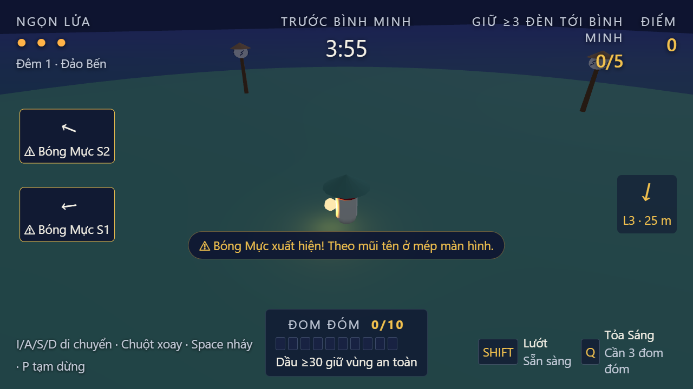

# Đảo Đèn Lồng — Bình minh v1.0.0

Game 3D TypeScript + Three.js: cùng Mây gom đom đóm và giữ ba hòn đảo sáng
tới bình minh. **Ticket-04 / Phase 4 / Test Contract 1.3**; luật nhiên liệu,
Bóng Mực hút dầu và thắng ở bình minh của Phase 3 được giữ nguyên.



[Video demo MP4](docs/demo/demo.mp4) · [Bằng chứng](docs/proof/phase-4/README.md) ·
[Retro bốn phase](docs/retro.md) ([bản in2trang](docs/retro.html)) · [Changelog](CHANGELOG.md) · [Credits](CREDITS.md)

[Tải bản phát hành v1.0.0](https://github.com/vuductam20022004/K5-L3A-DAY12-VuDucTam-2A202603522-AI-SDLC-Dao-Den-Long/releases/tag/v1.0.0):
ZIP chạy được, video demo và báo cáo benchmark/soak. Repo public, CI kiểm chứng
và workflow Release đã chạy thành công; chi tiết trong proof Phase4.

## Cài và chơi — ba lệnh

Cần **Node.js22+**, npm, trình duyệt WebGL2 (Chrome/Edge), bàn phím và chuột,
màn hình1280×720 trở lên. Máy cần GPU/driver hỗ trợ WebGL2; benchmark local
trong proof là số tham khảo, máy chấm giảng viên mới quyết định ngưỡng cuối.
Không dùng CDN hoặc tải asset trong khi chơi.

```bash
npm ci
npm run build
npm start
```

Mở `http://127.0.0.1:5173`. Trên PowerShell nếu execution policy chặn npm.ps1,
dùng `npm.cmd` thay `npm`. Phát triển dùng `npm run dev` tại localhost:5173.
Âm thanh bắt đầu sau khi bấm Bắt đầu; cài đặt lưu theo địa chỉ trình duyệt.

Bản ZIP phát hành chứa web tĩnh và server/headless/soak đã bundle, **không cần
npm install**: giải nén, chạy `node dist/server.js`. Cần giữ server Node để bảng
điểm ghi xuống đĩa; mở index.html bằng file:// không phải cách chạy được hỗ trợ.
Tự tạo ZIP bằng `npm run package`; file ở `artifacts/release/dao-den-long-v1.0.0.zip`.
Lệnh này không tự đăng GitHub. Workflow release tạo Release khi push tag v1.0.0
lên repo cá nhân có Actions; trạng thái xuất bản xem trong proof.

## Điều khiển và tiếp cận

| Mặc định | Hành động |
|---|---|
| W/A/S/D hoặc mũi tên | Di chuyển theo camera |
| Click thế giới + chuột; hoặc giữ chuột kéo | Xoay camera |
| Space | Nhảy khi chạm đất |
| Shift | Lướt14m/s trong0,2s, hồi1,5s |
| E | Nạp/thắp lại/châm dầu đèn gần nhất nhận được trong2m |
| Q | Tỏa Sáng:3đom đóm, bán kính5m, hồi3s |
| P / Esc | Tạm dừng, tiếp tục |

Cài đặt cho đổi **cả9hành động**, báo trùng phím, khôi phục mặc định và lưu lại.
HUD/lời nhắc dùng phím mới. Esc vẫn là phím phụ nếu chưa gán cho hành động khác.
Mũi tên di chuyển chỉ làm phím phụ khi hướng tương ứng vẫn dùng phím mặc định
và mũi tên ấy chưa được gán. Âm lượng, độ nhạy chuột, bảng màu dễ phân biệt,
giảm chuyển động và chữ lớn×1.25 cũng được lưu. Chữ UI tối thiểu18px ở1280×720.

Bảng màu đổi viền/mắt bóng sang xanh lam, cảnh báo trắng kèm⚠. Đèn tắt xẹp20%
và giấy rách. Giảm chuyển động tắt chớp khi bị đánh và các chuyển động trang trí;
game không có rung camera. Mũi tên/caption báo bóng xuất hiện; HUD báo trước gió,
10giây cuối và đèn dưới30dầu. Các menu dài có thể cuộn bằng bàn phím/chuột.

## Luật và điểm

Ba Đêm dài240/270/300giây. Chỉ thắng khi tới bình minh, còn lửa và ít nhất
**3/5,4/6,5/7đèn** đang sáng. Đủ đèn sớm vẫn phải giữ tới hết giờ. Hết3Ngọn Lửa
luôn thua trước, kể cả tick cuối. Có thể chơi lại Đêm thua; thắng Đêm3 tới Bình Minh.

Thắp mới10đom đóm, thắp lại5; có thể nạp từng phần. Mỗi lần thắp có100dầu,
hao1/giây; châm thêm10dầu mỗi đom đóm. Dầu≥30 tạo vùng an toàn6m; dưới30 thì
bóng wander tới hút thêm5dầu/giây/con. Tỏa Sáng ngắt hút, châm lên≥30 đẩy bóng
ra ngoài. Túi10+tăng2 mỗi lần thắp, tối đa20; reset đầu Đêm.

| Hành động | Điểm |
|---|---:|
| Mỗi đom đóm nạp/châm | +5 |
| Thắp lần đầu / thắp lại | +100 / +40 |
| Tỏa Sáng trúng bóng / bóng đang drain | Tổng+5 / +15 mỗi con mỗi lần |
| Bình minh thắng: mỗi đèn sáng | +50+floor(dầu thật còn lại) |
| Bình minh thắng: mỗi Ngọn Lửa | +50 |

Không thưởng nhặt hoặc thời gian. Tổng chiến dịch chỉ gồm **các Đêm đã thắng**.
Đảo Cau có cầu/bục nhảy, Đảo Chuông có ba tầng/dốc/gió; Gió Lạc cướp đom đóm,
Tỏa Sáng lấy lại khi nó chạy trốn; Bùa Gió cho10giây chạy nhanh/lướt không hồi.

## Bảng xếp hạng lưu đĩa

Sau thua hoặc Bình Minh, nhập3–12ký tự `A-Za-z0-9_` để lưu tổng điểm các Đêm
đã thắng. Giữ top10, điểm giảm dần; bằng điểm thì thời điểm đạt trước đứng trên.
Mỗi dòng có name/score/nights_won/achieved_at ISO có múi giờ/seed. Menu có
Bảng xếp hạng. Server ghi atomic vào `data/leaderboard.json`, còn sau đóng/mở;
giữ thư mục data khi nâng cấp. Không dùng điểm QA trong bảng của người chơi.

```bash
node dist/server.js --export-leaderboard out.json
```

`game.contract.json.run_cmd` là `node dist/server.js`. Có thể đổi data bằng
`--data-dir <folder>` hoặc biến `DAO_DATA_DIR`; export phải dùng cùng thư mục.
Server mặc định chỉ nghe localhost, đổi cổng bằng `--port`.

## Kiểm thử và headless

```bash
npm test
npm run verify
npm run test:gui
node dist/headless.js --seed 1 --night 3 --ticks 18000 --out out.jsonl
```

`bash scripts/verify.sh` tương đương verify. GUI test cần Chrome/Edge cài sẵn,
có thể đặt `CHROME_PATH`. Profile và data test riêng trong artifacts/.
Verify kiểm160test,23scenario có assertion, tất định3Đêm, input sai exit2,
fullnight và24trace Phase3 khớp từng byte; giữ nguyên proof/tag cũ.

Headless thêm `--scenario <json> --inputs <json> --snapshot-every <int>`.
Tick0 sau scenario, trước input; tick/snapshot/đơn vị và edge-trigger theo
contract. JSONL bắt đầu snapshot và kết thúc end, stdout sạch; malformed
input/scenario/CLI trả2. Pause tăng tick nhưng không tăng sim_tick.

## Benchmark và soak

Sau build:

```bash
node scripts/bench.mjs --seed 42 --duration 30 --out bench.json
node --jitless --expose-gc dist/soak.js --seed 7 --nights 10 --out soak.json
```

Tương đương `npm run bench -- ...`, `npm run soak -- ...`; hai lệnh cũng có
trong game.contract.json. Benchmark tự mở **cửa sổ riêng1280×720**, không fullscreen,
3s khởi động rồi đo30s và thoát0. Chrome dùng `--disable-frame-rate-limit` và
`--disable-gpu-vsync` để bỏ giới hạn/vsync; flags và browser thực được lưu trong
bench.metadata.json. Định nghĩa flags: [Chromium viz](https://chromium.googlesource.com/chromium/src/+/HEAD/components/viz/common/switches.cc),
[Chromium GL](https://chromium.googlesource.com/chromium/src/+/master/ui/gl/gl_switches.cc).
Không chạy test/quay video đồng thời khi đo.

Cảnh giữ đủ5đèn của Đêm1, L1–L3 sángfuel100,200wander và100đom đóm; Mây đứng
yên0, camera bán kính30/y15/chu kỳ15s. Không spawn/hit/pickup/hao dầu/kết thúc.
Renderer dùng cùng ánh sáng và hiệu ứng chuẩn, instancing khi nhiều thực thể;
không có hiệu ứng sáng tạo thêm trong cảnh đo. Rawdt lưu bench.frames.json;
avg=N×1000/Σdt, p1-low từ ceil(1%N)dt chậm nhất, p95 nearest-rank. Hai khoảng
dt cắt ở ranh giới để khoảng đo đúng duration. load gồm launcher/server/browser
đến frame đầu đã render. Web nhiều tiến trình không đo RSS riêng game đáng tin
cậy nên **peak_mem_mb=null**; không thay bằng JS heap.

Soak một tiến trình10Đêm, seed7+i với i=0..9, vòng1→2→3. Mỗi30tick đổi hướng;
xác suất từngtick jump5%/dash3%/pulse2%/interact10%. Lệnh công khai dùng V8
interpreter `--jitless`, tránh tăng RSS do mã JIT; `--expose-gc` thu gom tại hai
mốc RSS (sau tải Đêm đầu, sau reset Đêm cuối). Đo RSS thật, không điều chỉnh.
Kết quả ngẫu nhiên có thể cả10Đêm đều thua; không ép thắng để làm đẹp báo cáo.

Lần đo local: **155,4FPS trung bình,68,6FPS p1-low,10,2ms p95,1.291ms load**.
Soak0crash, RSS dưới1,2×. File gốc [bench.json](bench.json)/[soak.json](soak.json)
và cấu hình/ảnh/rawdt được commit. Không khẳng định số này là kết quả máy chấm.

## Sáng tạo của tôi

Mây với nón/khăn đỏ, lời Ông Đăng, ba đảo lấy cảm hứng Việt Nam, đèn giấy ấm,
biển mây và nhạc/SFX tổng hợp Web Audio. Toàn bộ hình/âm tạo bằng mã, không
asset ngoài. Phần trang trí không thêm thực thể hay thay output headless; cảnh
benchmark/soak chỉ dùng nội dung chuẩn. Chi tiết tại CREDITS.md.

## Cấu trúc và phát hành

- src/core: logic thuần seeded; game.contract.json là tuning duy nhất.
- src/render: Three.js/UI/audio; src/server: bảng điểm cục bộ; src/bench: đoRAF.
- docs/spec, docs/notes: acceptance, ADR, assumptions và AI log.
- docs/proof/phase-N: output thật; skills/verify-phase4: harness kiểm chứng.
- docs/release/v1.0.0.md: ghi chú release; docs/demo/demo.mp4: demo dưới5phút.

LICENSE MIT. Chưa có test ẩn của giảng viên để tự xác nhận; bằng chứng công khai
nêu đúng phạm vi đã chạy. Repo mẫu lớp được giữ ở remote upstream; origin là repo cá nhân.
